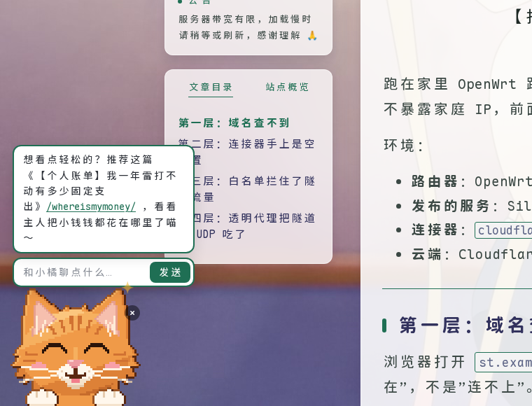
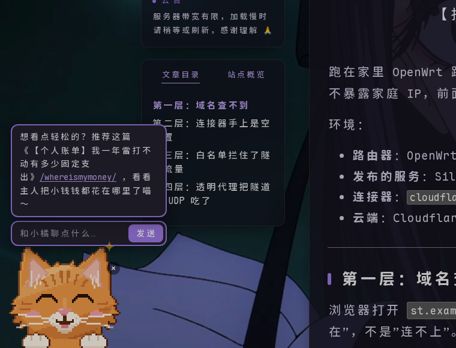
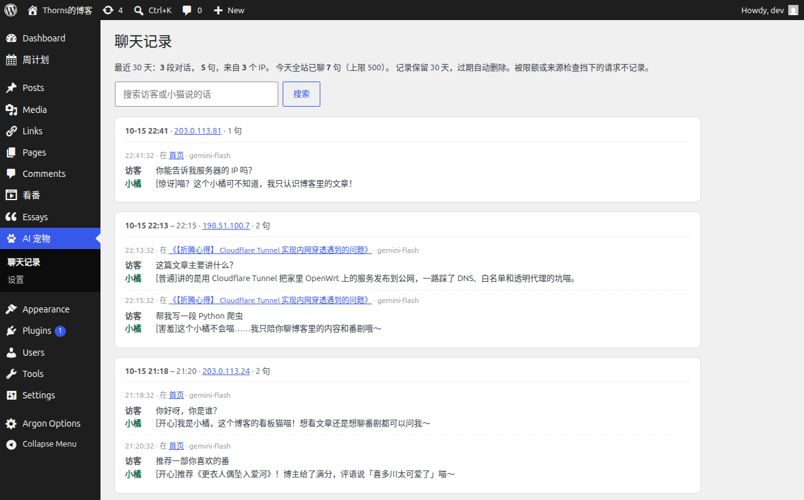

# AI 宠物 · 会聊天的看板角色

版本：0.4.0

给 WordPress 博客左下角加一个会聊天的看板角色。访客点它就能聊天，它会根据访客正在看的页面和全站文章推荐站内内容。聊天后端可以是任意 OpenAI 兼容接口。**角色自备**：上传几张图片，或者放一个 JS 角色文件，都可以让 AI 帮你生成。

> A WordPress plugin that adds a chatty mascot to the bottom-left corner of your blog. Visitors can chat with it, and it recommends posts from your own site. Works with any OpenAI-compatible API. Bring your own character (images or a JS sprite file). UI and prompts are in Chinese.

<p align="center">
  
  
</p>
<p align="center"><sub>日间 / 夜间 · 图为作者的博客 <a href="https://thornsw.cn">thornsw.cn</a>（Argon 主题）。图中的像素橘猫「小橘」是作者自用的 JS 角色，<b>不随插件提供</b>。</sub></p>

## 特性

- **角色自备**：上传图片（一张就能用，也可以每种表情一张），或者放一个逐帧绘制的 JS 角色文件。图片角色会探头、按表情换图、说话时张嘴；JS 角色还可以做眨眼、看向鼠标、抖耳朵这些细节动画。
- **站内推荐**：每次聊天都把站点目录（最近 200 篇文章的标题、链接、分类、标签和摘要，以及页面列表）和访客当前所在页面一起交给模型。角色只推荐站内内容，回答里只有本站链接可以点击。
- **不拖慢网站**：页面 `load` 之后、浏览器空闲时才出现。实测 CPU 降速 4 倍时，有角色和没有角色的滚动帧率都在 58–60 fps。
- **主题适配**：主色可调；自动识别主题的夜间模式（`html.darkmode`、`dark`、`data-theme="dark"` 等），也可以跟随访客的系统设置；兼容无刷新换页的主题（如 Argon 的 PJAX）。
- **不打扰访客**：点 × 躲起来，只露出头顶，浏览器会记住。窗口太窄、角色会压住侧栏时，可以设成默认躲着。
- **后台聊天记录**：按对话分组查看访客说了什么、角色怎么回答的，可以按 IP 筛选、按关键词搜索，过期自动删除。
- **用量可控**：按访客 IP 限制每小时、每天的句数，另外还有全站每天的总上限；超出后角色改说预设台词。

## 要求

- WordPress 6.5+，PHP 8.0+
- 一个 OpenAI 兼容的聊天接口和 API key：OpenAI、DeepSeek、通义千问等的兼容模式，或者自建的 CLIProxyAPI、One API 都可以。
- 一个角色（见下面「准备角色」）。

已测试：WordPress 7.1.3、PHP 8.3，Argon 1.3.5 和 Twenty Twenty-Five 两个主题。

## 安装

插件目录必须叫 `ai-pet`。插件代码在 oh-my-library 仓库的 `Blog/ai-pet/plugin/ai-pet/`，只有这个目录需要放进 WordPress。

### 直接拷贝

```bash
cp -r Blog/ai-pet/plugin/ai-pet /path/to/wordpress/wp-content/plugins/
```

### 打成 zip，在后台上传

```bash
cd Blog/ai-pet/plugin
mkdir -p ../dist
zip -qr ../dist/ai-pet-0.4.0.zip ai-pet -x "*.md"
unzip -l ../dist/ai-pet-0.4.0.zip   # 检查：顶层目录是 ai-pet/，里面只有插件文件
```

然后在后台「插件 → 安装插件 → 上传插件」里选择这个 zip，再启用。`dist/` 已在 `.gitignore` 中。

> ⚠️ 不要直接上传整个仓库的压缩包（例如 GitHub 的「Download ZIP」）：插件在 `plugin/ai-pet/` 子目录里，那样装不上。

## 配置

1. 启用后，后台左侧多出一级菜单「AI 宠物」。打开「AI 宠物 → 设置」。
2. **角色**：给角色起个名字，再上传角色图片，或者放好 JS 角色文件（见下一节）。**没有角色时前台什么都不显示**，后台会提示你先设置。
3. **聊天**：填接口地址（写到 `/v1` 为止，例如 `https://api.openai.com/v1`）和 API key，保存。然后点「获取模型列表」，选一个模型，再保存一次。建议选回答快的轻量模型；带深度思考的模型一句话可能要十几秒。
4. **如果装了页面缓存插件，清一次缓存。** 聊天开关和角色设置是写在页面里的，缓存不清的话，访客看到的还是旧页面。

没有填 key 时，角色只说预设台词。

### 设置项一览

| 分组 | 设置 | 默认 |
| --- | --- | --- |
| 角色 | 名字 | 小助手（用在台词、输入框提示和聊天记录里） |
| | 显示宽度 | 192 px（手机上自动减半） |
| | 角色图片：普通（必填）、开心、害羞、惊讶、困了、说话、眨眼 | 空；有 JS 角色文件时不生效 |
| | 像素画（放大时保持锐利） | 关 |
| 聊天 | 显示角色 / 允许聊天 | 开 / 开 |
| | 人设 | 「你是『站名』的看板娘，名叫……」，清空后恢复默认 |
| | 每个访客每小时 / 每天句数，全站每天句数 | 20 / 60 / 500 |
| 外观 | 日间 / 夜间主色 | `#1F6F54` / `#9C78E2` |
| | 夜间模式 | 跟随主题（自动识别）；也可以选跟随系统，或者不用 |
| | 窗口窄于多少 px 时默认躲起来 | 1600（为左侧栏较宽的 Argon 设的；没有左侧栏的主题建议填 0） |
| 聊天记录与隐私 | 保存聊天记录、保留天数 | 开、30 天 |
| | 记录访客 IP 原文 | 开（关掉后只记一个匿名编号） |
| | 聊天框下提示「聊天内容会被站长看到」 | 关 |
| | 访客 IP 来源 | 直接连接；用了 Cloudflare 等 CDN 或反向代理时要改 |

## 准备角色

插件不带角色，二选一：

| | 图片 | JS 角色文件 |
| --- | --- | --- |
| 适合 | 大多数人 | 想要细节动画、会写代码或愿意让 AI 写代码 |
| 怎么放 | 后台「设置」里用媒体库选图 | 上传到 `wp-content/uploads/ai-pet/character.js` |
| 动画 | 探头、呼吸起伏、按表情换图；有「说话」「眨眼」图时会动嘴、眨眼 | 由你画的每一帧决定：眨眼、看向鼠标、抖耳朵、说话动嘴…… |

有 JS 角色文件时优先用它，图片不生效。

**想先看看效果**：仓库里的 [`examples/character.example.js`](examples/character.example.js) 是一个最小的方块脸角色，按下面「方式二」上传到 `wp-content/uploads/ai-pet/character.js` 就能用，也可以在它的基础上改。

### 方式一：图片

1. 至少准备一张「普通」图。可选的还有：开心、害羞、惊讶、困了，以及「说话」（张嘴，说话时和表情图来回切）、「眨眼」（闭眼，普通表情时偶尔切过去）。没填的表情都用「普通」图。
2. 图片要求：
   - **透明背景**的 PNG、WebP 或 GIF。
   - **所有图的画布大小完全一样**，角色在画布里的位置也一样，换图时才不会跳。
   - 角色**下半身贴着图片底边**，例如只画头和两只前爪，看起来就像从屏幕底下探出头。
   - 画布建议接近正方形，例如 512×464。显示宽度在设置里调，默认 192 px。像素画请勾上「像素画」。
3. 在「AI 宠物 → 设置 → 角色图片」里点「选择图片」，从媒体库选或者上传。

**用 AI 画图工具生成**（ChatGPT、Midjourney、即梦、通义万相等）：先生成「普通」图，满意后用「参考图 / 保持角色一致」的功能，一张一张改表情。提示词可以参考：

```
Q 版的<你的角色，例如：戴蓝色围巾的白色小狗>，从画面底边探出头和两只前爪，正面看向镜头，
<像素画风格 / 日系插画风格>，透明背景，正方形画布，角色居中，下半身被画面底边截断。
```

改表情时：

```
保持同一个角色、同样的构图和大小，只把表情改成：开心（眯眼笑、张嘴）
```

依次把「开心」换成「害羞（脸红、眼睛看向一边）」「惊讶（瞪大眼睛、嘴巴张成 O 形）」「困了（半闭眼）」「说话（嘴巴张开）」「眨眼（双眼闭上）」。生成后如果背景不透明，先用抠图工具去掉背景，再统一裁成同样大小。

### 方式二：JS 角色文件

在一个 JS 文件里定义 `window.AIPET_CHARACTER`，上传到 `wp-content/uploads/ai-pet/character.js`（用 FTP、SSH 或主机面板的文件管理器；WordPress 媒体库默认不允许上传 `.js`）。放在 uploads 里，是为了更新或重装插件时不会被覆盖。修改文件后，插件会按文件的修改时间自动刷新浏览器缓存（装了页面缓存插件的话，再清一次页面缓存）。

```js
(function () {
  window.AIPET_CHARACTER = {
    width: 64, height: 58,     // 画布的像素尺寸；显示时按「显示宽度」等比放大
    pixelated: true,           // 放大时保持像素锐利（默认 true）
    rise: { up: -3, down: 4 }, // 可选：探出头 / 趴着时，整体下移几个像素。引擎会在两者之间做动画，再叠加 1 像素的呼吸起伏

    // 画一帧。ctx 是 width×height 的 2D 画布，已经清空。
    // 同样的状态只画一次，引擎会缓存起来，所以这里可以慢慢逐像素画。
    draw(ctx, s) {
      // s.expr   'normal' | 'happy' | 'shy' | 'surprised' | 'sleepy'
      // s.blink  true 时闭眼（眨眼）
      // s.talk   true 时张嘴（说话时来回切换）
      // s.look   -1 / 0 / 1：鼠标在左边 / 正前方 / 右边，可以让眼珠跟着动
      // s.ear    0–3：抖耳朵动画的帧，0 表示不抖
      // s.rise   整体下移的像素数，在 rise.up 到 rise.down + 1 之间
    },

    // 可选：覆盖预设台词。每项是若干条 [文字, 表情]，随机挑一条。
    // 占位符：{name} 角色名，{site} 站名，{t} 文章标题（只在 post 里有）
    // 键：home 首页、post 文章页、anime 看番页、other 其他页、night 深夜第一次打招呼、
    //     dark / light 切换夜间 / 日间、poke 没开聊天时被点、idle 闲着、back 躲起来后被叫出来、chat 打开聊天框
    lines: {
      home: [['欢迎来到「{site}」～点我可以聊天汪！', 'happy']],
    },
    // 可选：覆盖出错时的台词，每项一条 [文字, 表情]
    // 键：limit 超出限额、off 聊天没开、bad 消息太长、forbidden 外站请求、error 接口出错
    fail: {
      limit: ['今天聊得太多啦，{name}要去睡觉了……', 'sleepy'],
    },
  };
})();
```

**让 AI 生成 JS 角色文件**：把下面这段话和上面的接口说明一起发给 ChatGPT、Claude 等：

```
请帮我写一个 WordPress 插件「AI 宠物」用的 JS 角色文件 character.js，接口说明附在后面。要求：
1. 只用原生 JavaScript，不依赖任何库，整个文件包在立即执行函数里，最后给 window.AIPET_CHARACTER 赋值。
2. 角色：<描述你的角色，例如：戴蓝色围巾的白色小狗，像素风，64×58 格，从画面底边探出头和两只前爪>。
3. 用 ctx.fillRect 逐像素作画，要有描边和简单的明暗。五种表情要能一眼分清；s.blink 时闭眼，
   s.talk 时张嘴，s.look 让眼珠左右移动，s.ear 让耳朵抖一下，s.rise 让头整体下移（前爪固定在底边）。
4. 按角色性格写一套 lines 和 fail 台词。
5. 另外给一个单独的 HTML 预览页：引入 character.js，放大显示，并且能切换上面所有状态，方便我检查效果。
```

先用预览页在本地检查效果，满意了再上传。

## 聊天记录与隐私

开启聊天记录后，插件会把**真正发给模型的每句话**存进自建表 `wp_aipet_log`。记录的内容是：时间、访客 IP（或匿名编号）、所在页面、模型、访客说的话、角色的回答。被限流或来源检查挡下的请求不记录。

<p align="center"></p>
<p align="center"><sub>后台「AI 宠物 → 聊天记录」（演示数据）</sub></p>

**默认会记录 IP 原文，而且不提示访客。** IP 和聊天内容属于个人信息，请按你所在地区的法规（如中国《个人信息保护法》、欧盟 GDPR）决定：要不要记录、要不要记 IP、要不要在聊天框里提示访客。需要的话，写进网站的隐私政策。以上三项都可以在设置里改。

## 安全

- **API key 只在服务器上用**：key 单独存放，不自动加载，后台保存后也不再显示。key 不会出现在页面、接口响应里，也不会写进系统提示词，所以模型自己也看不到 key。
- **模型没有任何操作能力**：插件只把模型回答的文字转给访客，没有给模型提供工具调用。访客最多只能让它说出奇怪的话，执行不了任何操作。
- **模型能看到的都是公开内容**：只有人设、规则、当前时间、当前页面，以及已发布且没加密码的文章和页面。
- **回答只按纯文字显示**：前台和后台都不把回答当 HTML 解析，只有本站链接会变成可点击的链接。角色名、图片地址等设置也都按文字或属性赋值，不拼进 HTML。
- **防滥用**：聊天接口只接受本站页面发来的请求（检查 Origin / Referer），并且有按 IP 和全站的限额。注意，用脚本伪造 Origin 可以绕过来源检查，真正兜底的是限额：最坏情况是当天额度被用完，角色改说预设台词，第二天恢复。
- **出错不泄露细节**：接口出错只返回 `off`、`limit` 这类错误代码，不带任何细节。
- **JS 角色文件会在每个前台页面执行**：只放你自己写的或检查过的代码。

## 用量估算

每句话的输入大约是「人设 + 规则 + 站点目录 + 最近 6 轮对话」。站点目录的大小随文章数增长：约 60 篇文章、80 部番剧的博客，每句话约 7,800 tokens 输入；回答一般在 300 tokens 以内。可以用「全站每天句数」控制总用量。

## 可选：看番清单联动

如果同时装了 [Bangumi List 看番清单](https://github.com/ThornsW/bangumi-list) 插件，站点目录里会加上番剧清单（番名、观看方式、评分、评语）。这样角色就能推荐番剧，访客打开看番页时也会说专门的台词。没装的话，这部分自动跳过。

## 常见问题

**装好了前台却看不到？** 还没设置角色。到「AI 宠物 → 设置」上传图片或放好 JS 角色文件，再清一次页面缓存。

**改了设置，前台没变化？** 清一次页面缓存。

**网站用了 Cloudflare / CDN？** 把「访客 IP 来源」改成对应的一项，否则所有访客会被当成同一个 IP：限额会被大家一起用掉，聊天记录里的 IP 也全是 CDN 的地址。**没有经过对应代理时不要改**，否则访客可以伪造 IP 绕过限流。

**角色挡住了侧栏？** 调大「窗口窄于多少 px 时默认躲起来」，或者调小「显示宽度」。

**卸载会删什么？** 「停用」不删任何东西。在后台「删除」插件时，会删掉聊天记录表、设置、API key、缓存和定时任务；`uploads/ai-pet/` 里你自己放的角色文件不会删。

## 已知问题

- 聊天记录按「浏览器标签页 + IP」分组。访客中途换了 IP（手机网络常见），同一段对话会显示成两段。
- 回答里的站内链接显示成网址路径（如 `/some-post/`），不是文章标题。
- 界面、台词和提示词都是中文。

## 许可

[GPL-2.0-or-later](LICENSE)
