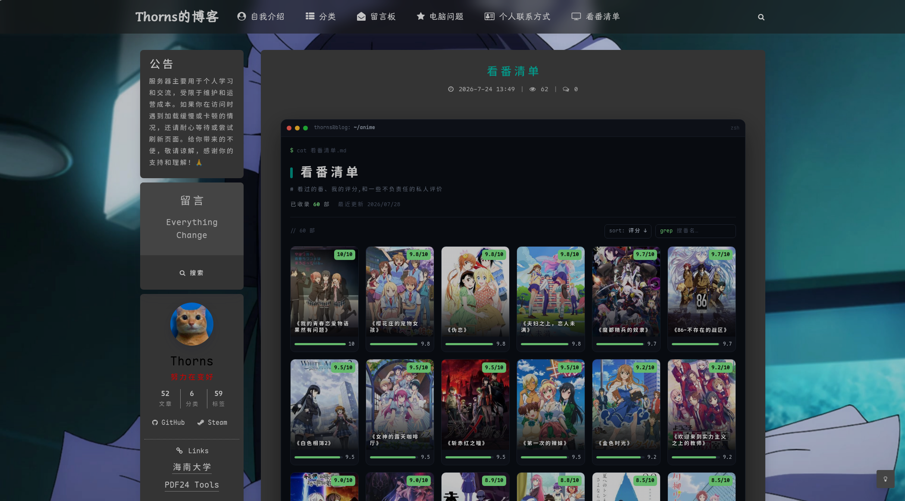

# Bangumi List 看番清单

版本：0.5.3

WordPress 插件：后台像写文章一样记录看过的番（封面、评分、评语），前台用终端风的海报网格展示，样式和主题互不影响。

> A WordPress plugin that adds a terminal-styled anime watch-list page. Manage entries in wp-admin, render anywhere with the `[anime_list]` shortcode.



<p align="center"><sub>短代码 <code>[anime_list]</code> 的前台效果，图为 <a href="https://thornsw.cn/anime">thornsw.cn/anime</a></sub></p>

## 特性

- 注册「动漫」内容类型，每部番可以记番名、封面、评分、评语、观看方式和 Bangumi 链接
- 评分按五档显示评级徽章；悬停或点按卡片看评语；填了链接的卡片可以跳转到 Bangumi
- 前端搜索，可按评分或最近添加排序，不用翻页
- 封面可以从 mikan / Bangumi 自动抓取，并过滤掉横版图；抓不到时用文字卡占位
- 样式都限定在 `.bgm-*` 下，不影响主题

## 要求

- WordPress 5.8+，PHP 7.4+
- 可选：WP-CLI，用来批量导入和抓封面

## 安装

插件目录必须叫 `bangumi-list`。只拷运行需要的文件；`docs/`、`tools/`、`examples/` 不要上传，Nginx 会把 `.md` 原样公开。

```bash
cd Blog/bangumi-list
mkdir -p /path/to/wp-content/plugins/bangumi-list
cp -r bangumi-list.php includes assets cli LICENSE /path/to/wp-content/plugins/bangumi-list/
```

想在后台「上传插件」里安装，就先打成 zip，顶层目录必须是 `bangumi-list/`：

```bash
cd Blog
zip -qr ~/bangumi-list.zip bangumi-list/bangumi-list.php bangumi-list/includes \
  bangumi-list/assets bangumi-list/cli bangumi-list/LICENSE
```

**旧版本**：在仓库根目录运行 `git log --oneline -- Blog/bangumi-list`，找到提交说明里带对应版本号的提交，再打包：

```bash
git archive --format=zip --prefix=bangumi-list/ -o ~/bangumi-list-0.4.0.zip \
  <提交号>:Blog/bangumi-list bangumi-list.php includes assets cli LICENSE
```

装好之后：

1. 在后台「插件」里启用 **Bangumi List 看番清单**
2. 新建一个页面，内容写短代码 `[anime_list]`，建议用全宽页面模板
3. 在后台「看番」里添加番剧，「特色图」就是封面

## 短代码

`[anime_list]`，可选属性：

| 属性 | 说明 | 默认 |
|---|---|---|
| `title` | 大标题 | `看番清单` |
| `subtitle` | 副标题 | `# 记录看过的番、我的评分与短评` |
| `handle` | 终端标题栏里的用户名 | `user@blog` |
| `path` | 终端路径标签 | `~/anime` |
| `accent` | 强调色（hex） | `#7ee787` |

例：`[anime_list title="我的番剧" handle="me@site" accent="#22d3ee"]`

## 批量导入（WP-CLI）

```bash
wp bangumi import /path/to/anime.json
```

JSON 格式参考 `examples/sample-anime.json`：

```json
[{ "title": "番名", "rating": "9.7", "review": "评语", "watch_mode": "常规" }]
```

- 按番名判重，重复执行也安全
- 评分和评语都为空，或者含「看不了 / G了」的条目会跳过
- 从 Excel 转 JSON 可以参考 `examples/xlsx_to_json.py`（需要 `openpyxl`）
- 评分写 `9.7` 或 `9.7/10` 都可以。想把旧数据里的 `/10` 去掉，运行 `wp bangumi normalize-ratings`，可以先加 `--dry-run` 看会改什么

## 封面

有三种方式：

1. **在本机抓好再入库**。覆盖率最好，也适合服务器访问不了 mikan 的情况：
   ```bash
   # 在服务器上导出番名
   wp post list --post_type=anime --post_status=publish --format=json --fields=ID,post_title > anime-list.json
   # 在本机抓图。只用 Python 3.7+ 标准库；需要代理时加 --proxy 或设 HTTPS_PROXY
   python3 tools/fetch-covers-local.py anime-list.json -o covers/
   # 传回服务器入库。可以加 --dry-run 预览，加 --overwrite 覆盖已有封面
   scp -r covers/ <your-server>:/tmp/covers
   ssh <your-server> 'wp bangumi import-covers /tmp/covers'
   ```
   常用参数：`--source mikan|bgm|both`、`--limit N`、`--delay`、`--proxy`。中断后重跑会跳过已经抓到的。
2. **在服务器上直接抓**，前提是服务器能访问 `api.bgm.tv`：先用 `wp bangumi fetch-covers --limit=10` 试一下，确认没问题再去掉 `--limit` 跑全部
3. **手动**：编辑番剧时设置「特色图」

抓取时有两道过滤，结果都写进 `manifest.json`：

- **比例**：默认只收宽 / 高在 `0.5–0.8` 之间的竖版图。前台的海报框是 3:4，横版图会被裁掉一半
- **标题比对**：搜索结果和番名对不上的跳过。某个图源只返回一条结果时会照样收下，但标成 `low_confidence`，结尾单独列出来，**务必核对**

另外注意：

- 不做繁简转换，繁体番名要先改成简体；番名里的错别字也要自己改
- 同一部番的不同季容易互相匹配错，抓完对照 `manifest.json` 里的 `matched_name` 检查一遍
- 抓不到的条目不会动原有封面；被替换掉的旧图还留在媒体库里，需要时自己清理
- 请求间隔默认 0.8 秒，最低 0.3 秒。两个图源都是公益站点，**请勿调低**

## 批量补 Bangumi 链接

`tools/fetch-links-local.py` 用来给番剧批量补 `_bgm_url`，用法和抓封面相同：

```bash
python3 tools/fetch-links-local.py needlink.json -o links.json
```

链接配错了，页面上是看不出来的。入库前要核对脚本结尾的两份报告：**重复 subject_id**，多半是季数串了；**低分**结果，可能只是译名不同，也可能真的配错了。这两份报告只覆盖本批次，库里已有的链接要合在一起比对。

## 自定义

| 想改什么 | 怎么改 |
|---|---|
| 标题、用户名、强调色 | 短代码属性 |
| 评级档位 | 过滤器 `bangumi_list_rating_tiers`，见下文 |
| 封面比例、最小宽度 | 过滤器 `bangumi_list_cover_ratio_range`、`bangumi_list_cover_min_width`；本机脚本对应 `--ratio-min`、`--ratio-max`、`--min-width` |
| 抓取用的 User-Agent | 过滤器 `bangumi_list_user_agent` |
| 字体 | 默认等宽字体栈，首选 Maple Mono NF CN，可以在主题里自托管 |
| 界面文字 | 写死在代码里的简体中文，改 `includes/render.php` 和 `assets/anime.js` |

```php
// 允许接近正方形的封面，最小宽度改成 300px
add_filter('bangumi_list_cover_ratio_range', fn() => [0.5, 1.05]);
add_filter('bangumi_list_cover_min_width', fn() => 300);
```

### 评级档位

默认档位如下。区间含上限、不含下限，没有评分时显示 `—`：

| 档位 | 区间 | 颜色 |
|---|---|---|
| 神作 | ≥ 9.5 | 绿 |
| 还不错 | 8.5 – 9.5 | 蓝 |
| NPC | 7.5 – 8.5 | 灰 |
| 拉完了 | 6.7 – 7.5 | 橙 |
| 神了 | < 6.7 | 红 |

在主题的 `functions.php` 里可以整表替换：

```php
add_filter('bangumi_list_rating_tiers', fn() => [
    ['min' => 9.0,  'key' => 'god',  'label' => '神作'],
    ['min' => 8.0,  'key' => 'good', 'label' => '推荐'],
    ['min' => 7.0,  'key' => 'npc',  'label' => '一般'],
    ['min' => 6.0,  'key' => 'meh',  'label' => '较差'],
    ['min' => null, 'key' => 'bad',  'label' => '不推荐'],
]);
```

- `min` 从高到低排，最后一档写 `null` 兜底
- `key` 对应配色，即 `assets/anime.css` 里的 `.bgm-badge.bgm-t-*`。换成新的 `key` 要自己补样式

## 数据模型

内容类型 `anime`，各字段存在 post meta 里：

- `_bgm_rating_text`：评分原文
- `_bgm_rating_value`：解析出的数字，用于排序和分档
- `_bgm_review`：评语
- `_bgm_watch_mode`：观看方式
- `_bgm_url`：Bangumi 链接

## 其他

- 用了页面缓存插件的，改动后记得清缓存
- 番剧数据和封面来自 [Bangumi 番组计划](https://bgm.tv) 和 [蜜柑计划](https://mikanani.me)。封面版权归各自的版权方，本插件只把图片下载到你自己的媒体库，仅供个人博客展示，请勿商用

## 许可证

GPL-2.0-or-later，详见 [LICENSE](LICENSE)。
